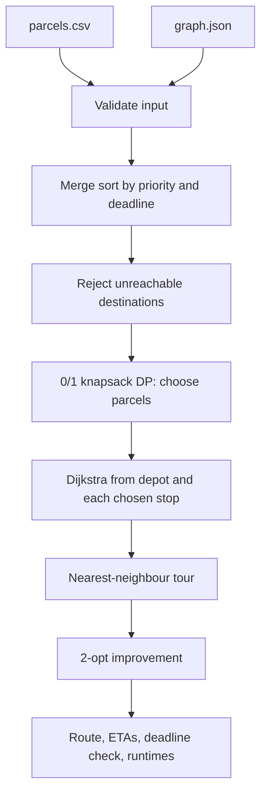

# Phase 1: Courier Problem Design and Planning

## Problem
A courier starts at a depot with one box of limited weight. Given parcels and a road
network, the system must (1) rank parcels by urgency, (2) choose which to carry on
this trip, (3) find shortest paths to their destinations, and (4) order the stops
into a round trip.

**Objective:** maximise the total parcel value within capacity, then keep the round
trip for the chosen parcels short.

## Data design
**Parcel** (`parcels.csv`)

| Field | Meaning | Rule |
|---|---|---|
| id | parcel identifier | unique |
| destination | delivery point | graph node (otherwise rejected) |
| weight_kg | weight | positive, steps of 0.1 kg |
| priority | urgency | 1 (highest) to 5 (lowest) |
| deadline | latest delivery time | HH:MM |

**Value** = `(6 - priority) * 10 + max(0, floor((1080 - deadline_minutes) / 60))`

Priority sets the base score (10 to 50). Each full hour the deadline falls before
18:00 adds 1 point. This formula is a design choice and can be tuned. The DP
maximises the *sum* of values, so several lower-priority parcels can outweigh one
high-priority parcel.

**Graph** (`graph.json`): `depot`, `nodes`, and `edges` as `[from, to, km]`.
Roads are two-way with non-negative lengths, stored as an adjacency list.

## Pipeline

## Algorithm selection
| Task | Algorithm | Time | Why it suits the task |
|---|---|---|---|
| Prioritise | Merge sort | O(n log n) | Stable, with a guaranteed worst case |
| Pack | 0/1 knapsack DP | O(nW) | Parcels cannot be split; optimal for the value defined |
| Shortest paths | Dijkstra with binary heap | O((V+E) log V) | Non-negative road lengths |
| Order stops | Nearest neighbour | O(k^2) | Fast TSP heuristic; no optimality guarantee |
| Refine route | 2-opt (extension) | O(k^2) per pass | Removes inefficient segment orderings |

n = parcels, W = capacity in 0.1 kg units, V = nodes, E = roads, k = stops.

## Route-planning logic
Dijkstra runs from the depot and from every selected destination. This gives a
shortest-distance table between all stops, even when no direct road joins them.
Nearest neighbour uses that table, starting and ending at the depot. A leg may pass
through other nodes; the output lists the actual roads used. Parcels for the same
destination are delivered in one visit.

## Assumptions
One vehicle and one trip; constant speed of 25 km/h; 3 minutes per stop; departure
at 09:00; weight is the only box limit (no dimensions or volume). The packing plan
is therefore the list of parcels to load and the total weight, not a 3D layout.
Deadlines affect value and priority order and are checked after routing, but the
route itself does not enforce them.
