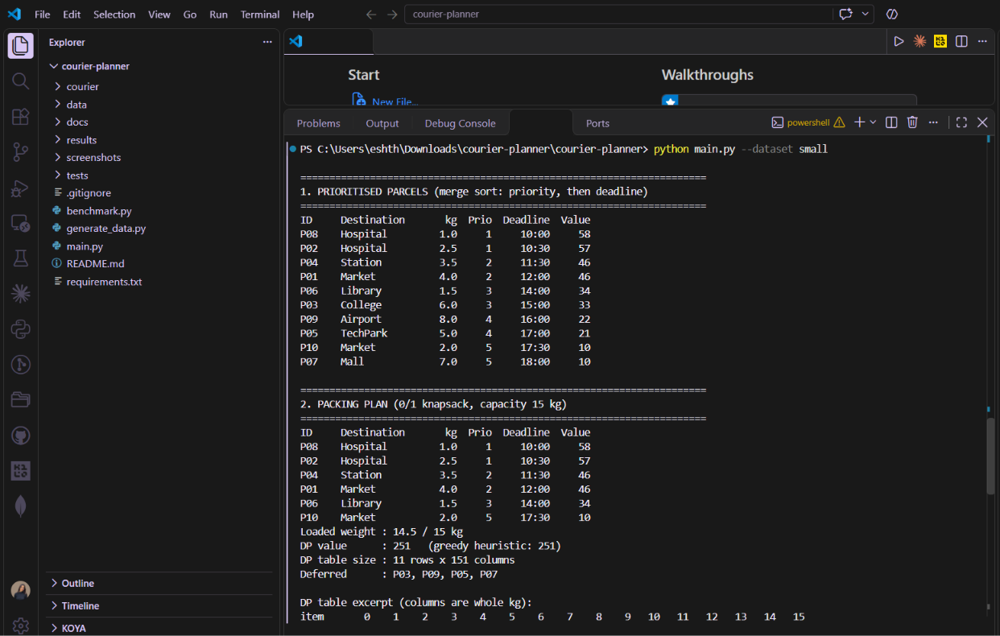
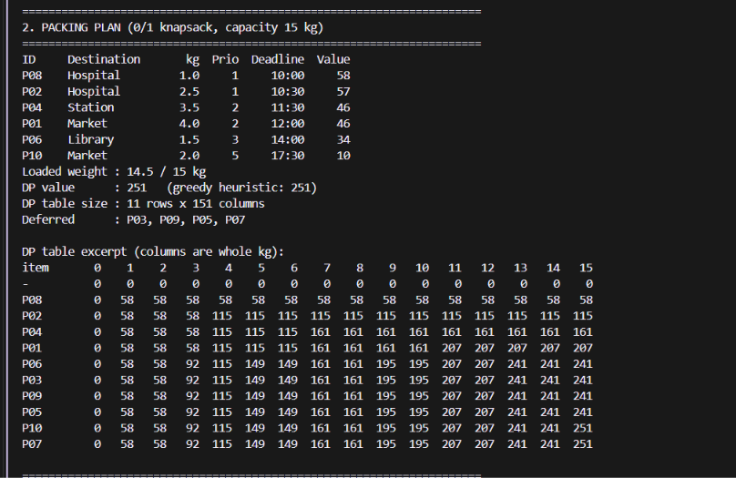
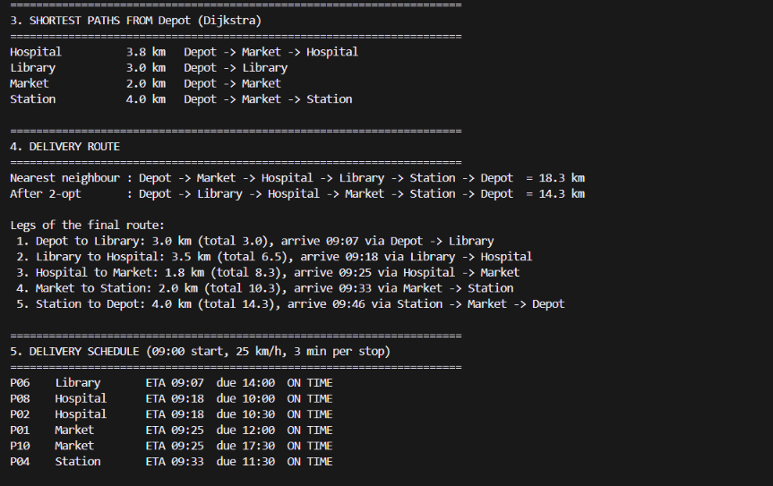
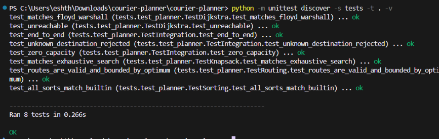
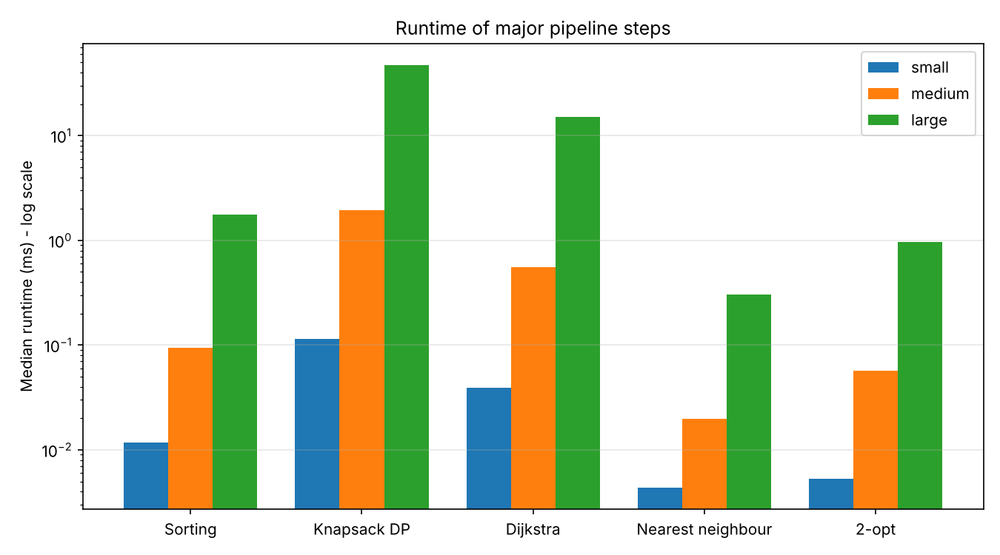
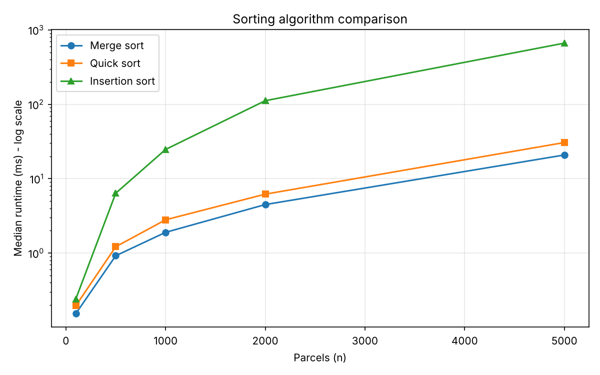
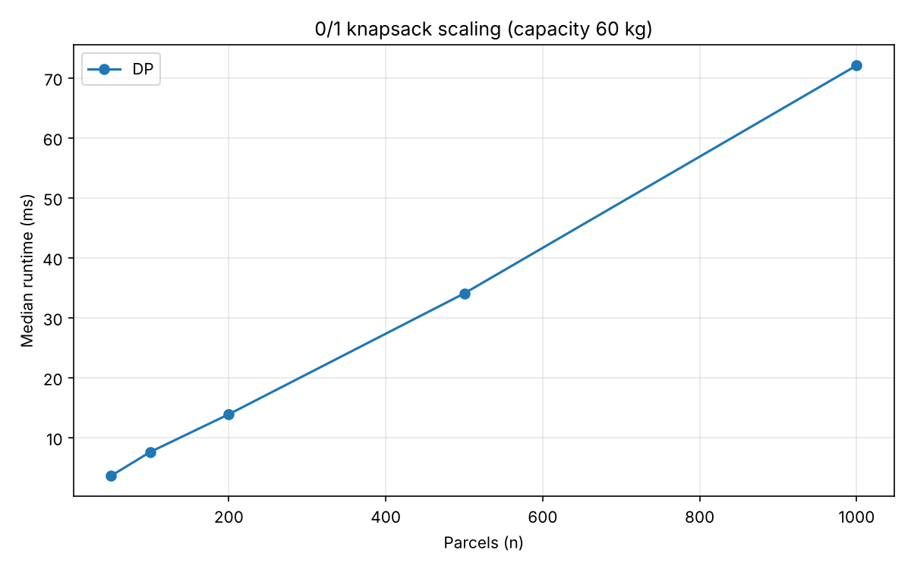
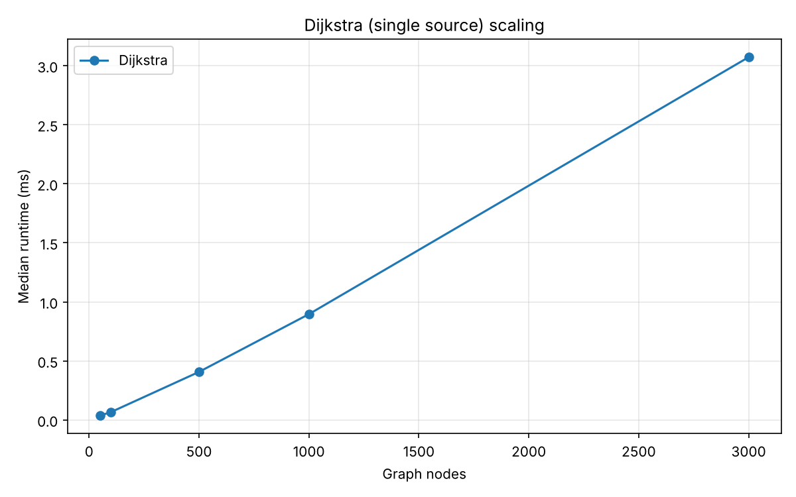
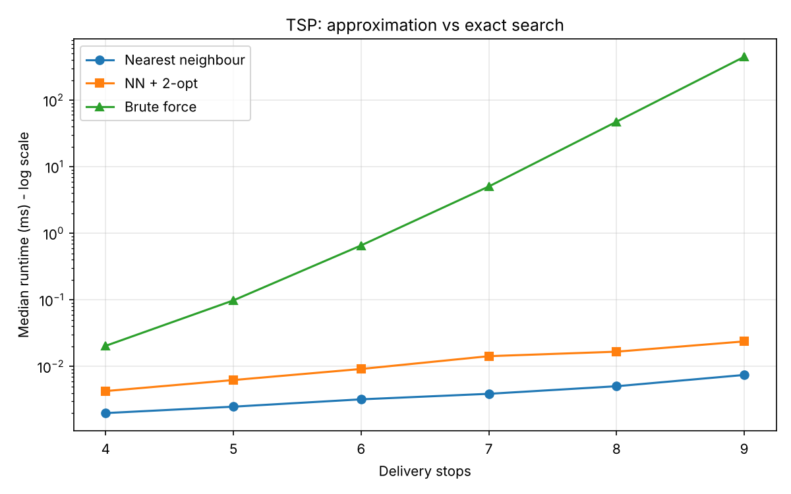

# Final Report: Intelligent Courier Planning System

**Name:** _Eshtha_  **Roll no.:** _2501730450_  **Course:** _BTech CSE AI/ML_

## 1. Summary
A Python prototype that sorts parcels, fills one delivery box using dynamic
programming, computes shortest road paths with Dijkstra, and builds a round trip
with nearest neighbour plus 2-opt. Design details are in [DESIGN.md](DESIGN.md).

## 2. Phase 2: prioritisation and box filling (small dataset, 15 kg)
- Merge sort orders by priority, then deadline, then ID: P08, P02, P04, P01, P06, P03, P09, P05, P10, P07.
- Selected: **P08, P02, P04, P01, P06, P10**. Weight **14.5 / 15 kg**, value **251**.
- Deferred: P03, P09, P05, P07.
- P10 (priority 5) is carried while P03 (priority 3) is not: P10 weighs 2 kg and fits;
  P03 weighs 6 kg and would force out more valuable parcels.
- Greedy by value/weight also scores 251 here. It scores 673 against the DP's 674 on
  the medium set, and 2440 against 2454 on the large set.

The full table is in `results/small/dp_table.csv`.

## 3. Phase 3: graph and route
| Destination | Shortest distance from depot | Path |
|---|---|---|
| Market | 2.0 km | Depot, Market |
| Hospital | 3.8 km | Depot, Market, Hospital |
| Library | 3.0 km | Depot, Library |
| Station | 4.0 km | Depot, Market, Station |

- Nearest neighbour: Depot, Market, Hospital, Library, Station, Depot = **18.3 km**
- After 2-opt: Depot, Library, Hospital, Market, Station, Depot = **14.3 km** (21.9% shorter)
- Check of the final length: 3.0 + 3.5 + 1.8 + 2.0 + 4.0 = 14.3 km
- All 6 selected parcels arrive on time; the courier returns at about 09:46.

## 4. Phase 4: testing and performance
### Test cases (`tests/test_planner.py`, 8 tests, all passing)
| Test | Evidence of correctness |
|---|---|
| Sorting | All three sorts match Python's `sorted` for sizes 0, 1, 2, 17, 200 |
| Knapsack | Matches exhaustive search on 100 random cases; capacity respected |
| Dijkstra | Matches Floyd-Warshall on 10 random graphs; path lengths agree |
| Unreachable node | Infinite distance and empty path |
| Routing | 15 maps: valid tours; 2-opt never worse than NN, never below the exact optimum |
| End to end | Capacity respected; route visits exactly the selected destinations |
| Zero capacity | Nothing selected; courier stays at depot |
| Unknown destination | Parcel rejected before packing |

### Pipeline results (median of 5 runs, Python 3.13, Linux)
Runtimes depend on the machine.

| Metric | Small | Medium | Large |
|---|---|---|---|
| Parcels / graph nodes | 10 / 9 | 60 / 40 | 500 / 300 |
| Capacity (kg) | 15 | 30 | 60 |
| Selected parcels / stops | 6 / 4 | 16 / 14 | 57 / 53 |
| Sorting (ms) | 0.012 | 0.094 | 1.774 |
| Knapsack (ms) | 0.115 | 1.955 | 47.339 |
| Dijkstra, all runs (ms) | 0.039 | 0.552 | 15.162 |
| Nearest neighbour (ms) | 0.004 | 0.020 | 0.305 |
| 2-opt (ms) | 0.005 | 0.057 | 0.963 |
| NN route, then 2-opt (km) | 18.3, 14.3 | 114.5, 102.1 | 265.9, 231.5 |
| Late parcels | 0 | 3 | 37 |

Knapsack is the slowest step in all three datasets. The Dijkstra timing includes the
depot run used to check reachability. File loading and report writing are not timed.

### Component scaling

At 5,000 parcels: merge sort 20.8 ms, quick sort 30.6 ms, insertion sort 664.5 ms.
Merge sort was the fastest of these three implementations at every tested size.
Python's built-in Timsort was not benchmarked.

With capacity fixed, DP time grows about linearly with parcel count, as O(nW) predicts.

| Stops (excluding depot) | Brute force (ms) | NN + 2-opt (ms) | NN gap | NN + 2-opt gap |
|---|---|---|---|---|
| 4 | 0.020 | 0.004 | 3.89% | 0.00% |
| 5 | 0.098 | 0.006 | 6.57% | 0.00% |
| 6 | 0.657 | 0.009 | 4.97% | 0.25% |
| 7 | 5.045 | 0.014 | 7.26% | 0.15% |
| 8 | 47.394 | 0.017 | 6.01% | 0.00% |
| 9 | 447.326 | 0.024 | 7.23% | 1.29% |

"Gap" is the mean extra distance over the exact optimum on 10 random maps per size.
These results do not guarantee the same quality on larger inputs.

## 5. Limitations
1. The route ignores deadlines while ordering stops, so 3 parcels (medium) and 37
   (large) arrive late.
2. Packing considers weight only.
3. One vehicle and one trip; deferred parcels are listed but not scheduled.
4. A high priority does not force a parcel into the box.
5. Travel speed is constant, and the larger datasets are synthetic.

## 6. Future optimisation
- Route with time windows (for example, cheapest insertion that rejects late stops).
- Make urgent parcels mandatory, then run the DP on the remaining capacity.
- Use a one-dimensional DP array when only the best value is needed. Recovering the
  selected parcels then needs extra decision records.
- Cache shortest paths between repeated trips.
- Plan several trips or vehicles; add a volume constraint.

## 7. Demonstration
Run the small dataset, explain output sections 1 to 6, change the capacity with
`--capacity 10`, run the tests, then show the charts.
